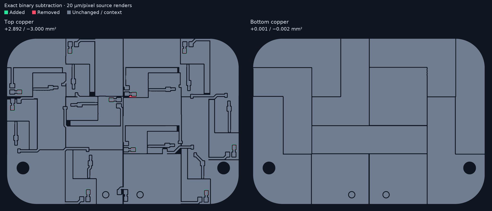
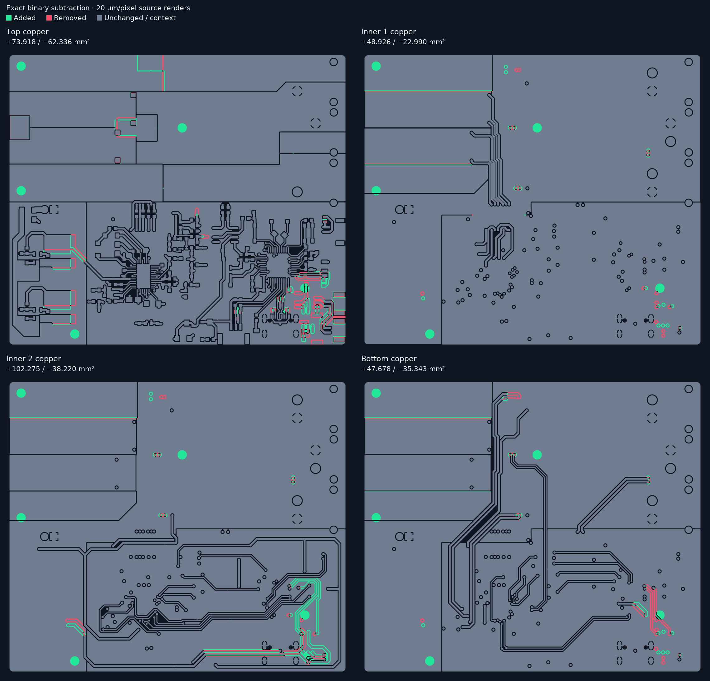

# PCB Diff

Compare two Gerber exports and save images of every matched layer. Inputs can be
two ZIP/RAR archives, two folders, or two individual Gerber files. All processing
is local. The tool includes a file-picker interface and a command-line interface.

[Download Windows app](https://github.com/weiliangng/pcb-diff/releases/latest) ·
[Quick start](#quick-start-windows) · [Examples](#examples) ·
[Read the results](#read-the-results) · [Command line](#command-line)

PCB Diff renders both versions on a common physical coordinate grid, subtracts
their artwork, and processes every matched layer in one run. Gerber input can
come from any EDA tool that exports supported Gerber artwork; native KiCad project
files are not required.

## Quick start (Windows)

Download the portable Windows ZIP from
[GitHub Releases](https://github.com/weiliangng/pcb-diff/releases/latest), extract
it, and run **PCB-Diff.exe**. The executable includes Python, the renderer and
Tcl/Tk, so no Python installation is needed. **pcb-diff-cli.exe** provides the
same comparison through a terminal:

```powershell
.\pcb-diff-cli.exe "older.zip" "newer.zip" -o "comparison"
```

### Use the desktop app

1. Open **PCB-Diff.exe**.
2. Beside **Older input**, click **File...** to select the old Gerber ZIP/RAR,
   or **Folder...** to select an extracted export.
3. Beside **Newer input**, select the revised export in the same way. To compare
   individual layers directly, select one Gerber file on each side instead.
4. Under **Save results**, choose the destination. **Choose...** creates a new
   timestamped comparison folder beneath the folder you select. A manually typed
   destination must be new or empty.
5. Start with **Pixels/mm: 50**, **Edge tolerance (mm): 0.02**, and **Layers: copper**.
   This renders at 20 micrometres per pixel and compares all identified copper
   layers. Select **all** to include recognized masks, silkscreen, paste, outline
   and documentation layers.
6. Click **Compare** and wait for **Finished**. Click **Open report** to inspect
   each layer and its enlarged change regions in your browser.

If automatic matching reports unknown or ambiguous layers, select a JSON file
under **Layer map (optional)**. See [Layer matching](#layer-matching) for its format.
The tool compares corresponding layers; two separately selected files are your
explicit choice of a pair.

### Run the Python source

1. Install Python 3.12 or newer from [python.org](https://www.python.org/downloads/).
2. Extract this whole tool folder, then run `setup-windows.cmd` once. Setup downloads
   the pinned dependencies into a private `.venv` inside the tool folder.
3. Run `launch-windows.cmd`, choose older and newer inputs, choose where to save,
   and click **Compare**. Click **Open report** when finished.

The tool makes no network requests when comparing files. Real RAR archives need
7-Zip or UnRAR; ZIP archives with a `.rar` filename work without those programs.
Prefer ZIP for an installation with no additional archive utility.

## Examples

These real comparisons correspond to the bank and SCV2 example reports. The
images use the original PNG outputs from the reports, so they remain sharp when
opened at full resolution. The example Gerber inputs are not bundled; substitute
your own older and newer exports in the commands below.

**Green: added artwork. Red: removed artwork. Gray: unchanged artwork in the
exact comparison.** Dark areas show where neither version has exposed artwork.
The colors describe the rendered layer; they do not identify components or nets.

### Bank: two copper layers, small localized edits

The top layer contains several small changes. The bottom layer's exact difference
is only +0.0008 / -0.0024 mm², with no changes surviving the 0.02 mm edge tolerance.
This example shows why an almost unchanged board can still have a few differing
edge pixels in the exact result.



An equivalent run for your own bank exports:

```powershell
.\pcb-diff-cli.exe "bank-old.zip" "bank-new.zip" -o "bank-comparison"
```

### SCV2: four copper layers

Top, inner 1, inner 2 and bottom copper are compared together. Each panel uses
the same board coordinates, making it easy to locate an edit across layers.
Green and red regions appear on all four layers in this example.



```powershell
.\pcb-diff-cli.exe "scv2-old.zip" "scv2-new.zip" -o "scv2-comparison"
```

### Inspect a changed region

In the HTML report, expand the **change groups** section under a layer to see its
largest detected regions. The crop below is from SCV2 bottom copper. Nearby red
and green paths show the old and new artwork around a routing edit; the exact
difference stays visible inside the crop.


Crops are selected from differences that survive the edge tolerance, then show
the exact colored subtraction inside each crop. The default exports up to twelve
crops per layer; every detected region is recorded in `results.json`.

## Read the results

1. Open **report.html** and select a layer using the links near the top.
2. Inspect **Exact difference** first. Green is newer-only artwork, red is
   older-only artwork, and gray is common artwork. The `+` and `-` values estimate
   added and removed area in mm².
3. Compare **Edge-tolerant difference** when you see thin fringes around otherwise
   matching edges. It suppresses changes within the selected physical distance
   of artwork in the opposite version. Gray here can include excluded changes.
4. Use **Older** and **Newer** to open the binary source renders, or expand the
   region crops for detail. Open an image directly to view it at full resolution.

The default 0.02 mm tolerance is one pixel at 50 pixels/mm. It can hide real edits
near an existing edge, so always retain the exact comparison. Increasing resolution
improves the representation of smaller features but increases memory use. The
added/removed area values are raster estimates, not an electrical correctness check.

### Save a report as a PDF

Open `report.html` in a browser, expand the region sections you want included,
then use **Print** and **Save as PDF**. Enable **Background graphics** to preserve
the report's dark background and color legend. Browser header/footer settings
control whether the document prints its date, URL and page numbers.
PDF creation uses the browser's print function; the app directly generates PNG,
HTML and JSON outputs.

## Command line

The standalone Windows executable uses the same options as the Python source:

```powershell
# Every matched copper layer from two export folders
.\pcb-diff-cli.exe "old-export" "new-export" -o "comparison"

# Add mask, silkscreen, paste, outline and documentation artwork
.\pcb-diff-cli.exe "old.zip" "new.zip" --scope all -o "all-artwork"

# Compare one corresponding Gerber pair directly
.\pcb-diff-cli.exe "old-top.gbr" "new-top.gbr" -o "top-layer"

# Render at 10 micrometres/pixel and disable secondary edge suppression
.\pcb-diff-cli.exe "old.zip" "new.zip" --dpmm 100 --tolerance-mm 0 -o "fine-comparison"

# Match unusual exporter filenames explicitly
.\pcb-diff-cli.exe "old.zip" "new.zip" --layer-map "my-layer-map.json" -o "mapped-comparison"
```

After Windows setup:

```powershell
.\.venv\Scripts\python.exe pcb_diff.py "older.zip" "newer.zip" -o "comparison"
```

On Windows, macOS or Linux with Python 3.12+:

```sh
python -m venv .venv
# Activate the environment using your platform's usual command.
python -m pip install -r requirements.txt
python pcb_diff.py older.zip newer.zip -o comparison
python pcb_diff.py older.gbr newer.gbr -o single-layer
python pcb_diff.py old-folder new-folder --scope all -o all-layers
python pcb_diff.py old.zip new.zip --dpmm 100 --tolerance-mm 0 -o high-resolution
python pcb_diff.py old.zip new.zip --layer-map examples/layer-map.json -o mapped
python pcb_diff.py --help
```

You can also install this folder with `python -m pip install .` to get the
`pcb-diff` and `pcb-diff-gui` commands. Linux GUI use may require your distribution's
`python3-tk` package. The command-line interface does not require Tkinter.

The output directory must be new or empty. The tool publishes it only after every
comparison succeeds, so completed results cannot be mixed with partial results.

## What gets saved

- `overview-exact.png`: all layers, with added artwork highlighted green and removed
  artwork highlighted red by default.
- `overview-tolerant.png`: the same comparison after excluding nearby edge differences.
- `<layer>-old.png`, `<layer>-new.png`: matching binary renders on the same canvas.
- `<layer>-diff-exact.png`, `<layer>-diff-tolerant.png`: full-resolution highlighted differences.
- `<layer>-added-mask.png`, `<layer>-removed-mask.png`: exact subtraction masks.
- `<layer>-added-tolerant-mask.png`, `<layer>-removed-tolerant-mask.png`: secondary masks.
- `<layer>-region-01.png`, etc.: full-resolution crops of the largest change groups.
- `report.html`: locally browsable report linking the images.
- `results.json`: input file hashes, settings, layer mapping, exclusions, physical
  bounds, area estimates and all detected change regions. Schema version is 1.

## Layer matching

There is no fixed layer count. Auto-matching prefers Gerber X2 `TF.FileFunction`
metadata, then known suffixes, then common KiCad names and EasyEDA layer comments.
The default scope selects copper. `--scope all` adds recognized mask, paste,
silkscreen, outline and documentation artwork.

Supported examples include `.GTL`, `.GBL`, `.G1` through any numbered inner `.Gn`,
`.GTS`, `.GBS`, `.GTO`, `.GBO`, `.GTP`, `.GBP`, `.GKO`, `.GDL`, `.GDD`,
Eagle `.cmp`/`.sol`, KiCad `F_Cu`, `B_Cu`, `InN_Cu`, `F_Mask`, `B_Mask`,
`F_Paste`, `B_Paste`, `F_Silkscreen`, `B_Silkscreen`, `Edge_Cuts`, and X2 roles.
`.GM1` is assumed to be a board outline; use a manual map if your exporter uses
it for a different mechanical layer.

Ambiguous duplicates, unknown Gerber roles, and missing counterparts stop the
automatic comparison. They are never silently paired by alphabetical order.
`--missing skip` explicitly excludes unmatched layers and records the exclusions.
`--missing empty` treats an absent layer as empty artwork and shows a whole layer
as added or removed.

For other exporters, edit a layer map. Paths are relative to the respective archive
root or input folder, including nested folders. A manual map overrides automatic
matching and scope; only its listed pairs are compared.

```json
{
  "layers": [
    {"name": "Top copper", "kind": "copper", "old": "old-top.gbr", "new": "new-top.gbr"},
    {"name": "Custom mechanical layer", "kind": "mechanical", "old": "mech-a.art", "new": "mech-b.art"}
  ]
}
```

Set one input to `null` to compare against empty artwork, together with
`--missing empty`. Two individually selected Gerber files are compared directly
regardless of filename; choose the corresponding layers yourself in that mode.

## Configurable settings

| Option | Default | Effect |
|---|---|---|
| `--scope` | `copper` | Copper only or all recognized artwork layers |
| `--layer-map` | automatic | Explicit pairs for custom naming or selected layers |
| `--missing` | `error` | Error, skip or compare against empty artwork |
| `--dpmm` | `50` | Pixels/mm; 50 means 20 µm/pixel |
| `--tolerance-mm` | `0.02` | Secondary Euclidean tolerance between pixel centres |
| `--tolerance-pixels` | unset | Alternative to physical tolerance |
| `--threshold` | `128` | Coverage threshold from 1 through 255 |
| `--new-offset-mm DX DY` | `0 0` | Explicit translation of all newer artwork |
| `--margin-mm` | `0.5` | Shared canvas margin |
| `--region-gap-mm` | `0.35` | Grouping radius for crops; never changes difference masks |
| `--crop-padding-mm` | `0.35` | Padding around each crop |
| `--max-crops` | `12` | Largest crops exported per layer; all regions remain in JSON |
| `--overview-columns` | `2` | Overview layout; independent of layer count |
| `--preview-width` | `1100` | Width limit of each overview layer image |
| `--palette` | provided palette | JSON colors; see `examples/palette.json` |
| `--max-megapixels` | `60` | Per-layer canvas limit to bound memory use |
| `--archive-tool` | discovered on PATH | 7-Zip/UnRAR executable for actual RAR input |

## What was hardcoded in the first script

<details>
<summary>Early prototype assumptions and how they became configurable</summary>

| First script assumption | This export |
|---|---|
| Four copper suffixes: GTL, G1, G2, GBL | Any number of recognized inner layers; X2/common names and manual mapping |
| Matching only by extension | Metadata-first matching plus explicit maps |
| Windows Segoe font and WinRAR installation path | Pillow font fallback; archive utility on PATH or user-specified path |
| Green/red/gray/dark palette | `--palette` file |
| 128 coverage threshold | `--threshold` |
| 0.5 mm canvas margin | `--margin-mm` |
| 0.35 mm grouping/padding; 12 crops | Independent configurable options |
| Two-column, four-layer overview wording | Arbitrary layer count and configurable columns/preview size |
| One-pixel square tolerance | Physical Euclidean tolerance, or explicit pixel tolerance |
| Archives/folders only | Also accepts two individual Gerber files |
| Absolute coordinates only | Preserved by default; explicit newer-version translation available |
| Output files written into an existing folder | Complete results published to a new or empty folder |

Resolution and pixel tolerance were already adjustable. Neither version hardcodes
your board dimensions or component locations. Gerber parsing supplies the units,
apertures, exposure polarity and geometry. Comments and companion documents are
treated as input data, not instructions.

The edge-tolerant results differ slightly from the first export because the
secondary tolerance now uses Euclidean distance instead of a square pixel
neighborhood. Exact subtraction is unchanged at the same settings and canvas.

</details>

## Extension points and remaining limits

- `pcb_diff/layers.py`: add exporter filename rules, archive adapters, layer roles,
  or alternate pairing strategies. Explicit maps handle unusual names without code changes.
- `pcb_diff/core.py`: reusable `compare(...)` API, render backend, tolerance,
  region grouping, images, report and versioned results schema.
- `pcb_diff/cli.py` and `pcb_diff/gui.py`: separate interfaces to the same pipeline.

Planned extension candidates: Excellon drill differences, drill-hole subtraction,
fiducial-based alignment, explicit rotation/mirroring, vector/geometry comparison,
electrical connectivity checks, raster tiling for large panels, SVG/PDF output,
CI change thresholds and additional executable platforms. Those are not implemented
in this release.

This version compares rendered Gerber exposures, not nets. Bottom copper is viewed
from above without mirroring. Mask/paste exposures should be interpreted as their
Gerber artwork, not as copper. Gerber units are converted to millimetres.
Small changes below the selected raster resolution can be missed. Exact binary
differences include edge pixels affected by rasterization; the secondary tolerance
can suppress real edits close to an existing edge, which is why exact images and
masks are always retained.

Frames use the union of all selected artwork and detected outlines; no automatic
translation, rotation or mirroring is applied. Actual RAR extraction depends on
the user's installed archive utility. Source-folder inputs should contain one
export per folder. Copper layers without usable role information need a map.

## Validation

Run from this tool folder:

```sh
python -m unittest discover -s tests -v
```

Tests cover scale/absolute coordinates, exposure polarity, identical inputs,
Euclidean tolerance, metadata and filename matching, arbitrary inner-layer count,
duplicates/missing layers, manual maps, archive signatures, output publication,
explicit translation, missing-as-empty and canvas size limits.

Rendering dependencies: [Gerbonara](https://gerbolyze.gitlab.io/gerbonara/),
[resvg-py](https://pypi.org/project/resvg-py/), Pillow, NumPy and SciPy.
Dependencies retain their own licenses. Tool source is provided for inspection
and modification; no distribution license is assigned by this export.

## Build and release

On Windows with a working source environment, run `build-windows.cmd`, or:

```powershell
python -m pip install -r requirements-build.txt
python scripts/build_windows.py
```

The build tests the core, creates `PCB-Diff.exe` and `pcb-diff-cli.exe` with
PyInstaller, executes a comparison through each binary, builds a source archive
and Python wheel, and packages the results under `release-assets/`.
The GUI executable test drives the real hidden file-picker interface through
its Compare action and checks the completed output and report button.

GitHub Actions runs tests on Linux and Windows for every main-branch push and
pull request. It then builds and tests the Windows binaries and retains them as
workflow artifacts. Actions are pinned to commit SHAs, with Dependabot configured
to propose updates. No repository secrets need to be added for release publishing.

To publish a version:

1. Update `pcb_diff/__init__.py` and the project version in `pyproject.toml` together.
2. Commit the version change and push a matching tag, such as `v1.0.1`.
3. The **Release** workflow checks the tag, builds and tests both executables,
   verifies the checksums, uploads the assets to a draft, and publishes it only
   after all those steps succeed.

Alternatively, run the Release workflow manually from GitHub Actions, entering
the matching version tag. This also creates the tag at the selected commit if it
doesn't already exist. Published releases are never silently overwritten; bump
the version for changes. Draft uploads can be retried.

Release assets include the portable Windows ZIP, each standalone executable,
the wheel and source archive, dependency versions, third-party license notices
and `SHA256SUMS.txt`. These are Windows x64 builds. Executables are not code-signed;
Windows may show its usual warning for a newly downloaded unsigned application.
